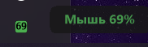

# FuryBattery

**Заряд мышки FuryCube G3 в трее Windows и оверлеем поверх игр.**
*Battery level of the FuryCube G3 mouse in the Windows tray and as an in-game overlay. English below.*

> ⚠️ Неофициальный проект, не связан с FURYCUBE. Работает только с **FuryCube G3** через **USB-донгл 2.4 ГГц**.

## Возможности

- Значок в трее с процентом заряда, цвет меняется: зелёный (>50%), жёлтый (21–50%), красный (≤20%), серый (мышь не на связи)
- Уведомления Windows при 20% и 10%
- Оверлей поверх окон: всегда / только при низком заряде / выключен, в любом из четырёх углов экрана
- Сквозь оверлей проходят клики, он не мешает играть
- Автозапуск вместе с Windows (галочка в меню)
- Ничего не нужно устанавливать: только PowerShell, который уже есть в Windows 10/11
- Фирменная программа FURYCUBEHUB для работы не нужна

## Установка

1. Скачайте репозиторий: зелёная кнопка **Code → Download ZIP**, распакуйте в постоянную папку (например, `Документы\FuryBattery`).
2. Правый клик по `FuryBattery.ps1` и `FuryBattery.vbs` → **Свойства** → поставьте галочку **«Разблокировать»** (если есть) → OK.
3. Запустите **`FuryBattery.vbs`** двойным кликом. Значок появится в трее у часов.
4. Правый клик по значку открывает настройки оверлея, автозапуск, диагностику и выход.

Если переместите папку, переключите галочку автозапуска заново.

## Ограничения

- Только FuryCube G3 и только через донгл. Bluetooth не поддерживается. Другие модели FuryCube (G1, G9 Pro и т.д.) используют другой протокол.
- В играх в режиме **«Полный экран»** Windows не даёт рисовать поверх игры. Используйте режим **«Окно без рамки» (Borderless)**.
- Некоторые антивирусы настороженно относятся к `.vbs`, который запускает PowerShell без окна. Весь код открыт: `FuryBattery.vbs` — 4 строки запуска, вся программа в `FuryBattery.ps1`.

## Как это работает

Донгл мышки (USB `1d57:fa60`) примерно раз в 2 секунды сам отправляет пакет `03 66 41 <состояние> <заряд %>`. Программа просто слушает его и ничего не отправляет мышке, поэтому настройки мышки не меняются.

Протокол разобран в проекте [furycube-g3-linux-bridge](https://github.com/HeyDSN/furycube-g3-linux-bridge) ([PROTOCOL.md](https://github.com/HeyDSN/furycube-g3-linux-bridge/blob/main/docs/PROTOCOL.md)). Спасибо автору!

Настройки хранятся в `%APPDATA%\FuryBattery\settings.txt`.

---

## English

Unofficial Windows tray app + overlay that shows the battery level of the **FuryCube G3** mouse (2.4 GHz dongle only). Not affiliated with FURYCUBE.

**Features:** tray icon with the percentage and colour (green / yellow / red / grey when the mouse is offline), Windows notifications at 20% and 10%, click-through overlay (always / only when low / off, any screen corner), start with Windows. No installation needed: it runs on the PowerShell that ships with Windows 10/11, and the vendor app (FURYCUBEHUB) is not required.

**Install:** Code → Download ZIP, extract to a permanent folder, right-click both files → Properties → tick **Unblock**, then double-click **`FuryBattery.vbs`**. Right-click the tray icon for settings.

**Limitations:** G3 via dongle only (no Bluetooth, other FuryCube models use a different protocol). The overlay is not visible in exclusive fullscreen games, so use borderless windowed mode. Some antivirus tools are wary of a `.vbs` file that starts a hidden PowerShell window. All code is in plain text in this repo.

**How it works:** the dongle (USB `1d57:fa60`) sends input report `03 66 41 <state> <battery %>` about every 2 seconds, and the app only listens for it. Protocol credit: [furycube-g3-linux-bridge](https://github.com/HeyDSN/furycube-g3-linux-bridge).

## License

[MIT](LICENSE)
